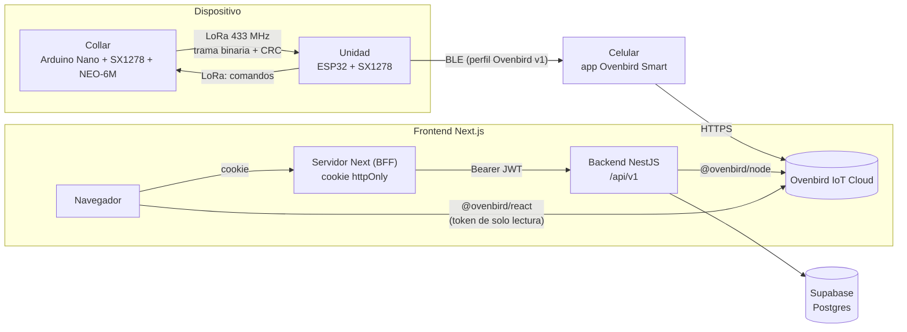

# TP Final IoT — Seguimiento de mascotas · Grupo 1 · Variante "Ahorro de energía"

Sistemas Distribuidos (UNMdP). Un **collar** (Arduino Nano + LoRa SX1278 + GPS NEO-6M) manda su
posición por LoRa a una **unidad** (ESP32 + LoRa + Bluetooth), que la publica por BLE a la app
**Ovenbird Smart**; la app la sube a **Ovenbird IoT Cloud**. Nuestro **backend NestJS** administra
usuarios, mascotas y collares, y el **frontend Next.js** muestra las mascotas en el mapa en vivo.

## Variante: ahorro de energía (`power-saving`)

El usuario elige, por mascota, entre **Normal** y **Ahorro**. En ahorro el collar reporta cada
150 s en vez de 15 s, apaga el GPS entre reportes, duerme la radio y el microcontrolador, **pero
sigue atendiendo órdenes**: después de cada reporte abre una ventana corta de escucha, y la unidad
le guarda los comandos para mandarlos justo en ese momento.

La ficha de la mascota tiene la tarjeta **"Batería y ahorro"**, que muestra:
- la batería actual;
- el interruptor Normal/Ahorro;
- si el collar ya aplicó el cambio ("Enviando…", "Aplicado en el collar" o "El collar no respondió");
- la **autonomía estimada de cada modo**, con la batería llena y con la carga actual.

| | Normal | Ahorro |
|---|---|---|
| Reporte | cada 15 s | cada 150 s |
| GPS | siempre encendido | solo 8 s antes de cada reporte |
| Radio | escucha continua | dormida; escucha solo después de cada reporte |
| Comandos | llegan al instante | la unidad los encola y los manda después del próximo reporte |
| Corriente media estimada | ≈ 57 mA | ≈ 5,9 mA |
| Autonomía (batería supuesta de 1000 mAh) | ≈ 18 h | ≈ 7 días |

La estimación sale de una función pura del backend (`backend/src/power/power-model.ts`, con test).
La función usa:
- las corrientes de datasheet del ATmega328P, el SX1278 y el NEO-6M;
- el tiempo en el aire de nuestra trama LoRa (28 bytes con SF7/BW125 ≈ 67 ms);
- la ventana de escucha y el intervalo de reporte.

La capacidad de 1000 mAh es un **supuesto**: todavía no sabemos qué batería va a llevar el collar.
Se configura con `BATTERY_CAPACITY_MAH`. Detalle en
[docs/03](docs/03-variante-ahorro-energia.md) y [docs/06 §4](docs/06-decisiones-arquitectura.md#4-variante-power-saving-back--front).

## Arquitectura



**En simulación** (sin placas), el mismo firmware corre en Wokwi. Wokwi no simula LoRa ni
Bluetooth, así que el script `firmware/tools/radiosim_bridge.py` reemplaza dos piezas:
- el "aire" entre collar y unidad;
- con `--cloud`, el celular: empareja la unidad, sube los datos y le pasa los comandos.

Con hardware real se cambia `*_sim` por `*_lora` y el script por el celular; el resto no cambia.

```
[Wokwi: collar] <--aire--> [Wokwi: unidad] <--"BLE" por consola--> [celular falso] --> Ovenbird --> back --> front
               \_____________ firmware/tools/radiosim_bridge.py _____________/
```

## Estructura del repositorio

```
firmware/   PlatformIO. lib/pet_protocol (lógica pura, testeada), lib/pet_radio (RadioSim/RadioLoRa),
            src/collar, src/unit, test/ (Unity), wokwi/ (diagramas y escenarios), tools/ (Python)
backend/    NestJS 11 + Jest. Módulos: auth, pets, devices, embed, capabilities, power, ovenbird, database
frontend/   Next.js 16 + Tailwind + shadcn/ui. src/lib/bff = intermediario con cookie
supabase/   config.toml + migrations/ (esquema de la base)
vendor/     SDK de Ovenbird (.tgz) que instalan backend y frontend
docs/       contrato entre grupos, plataforma, variante, Wokwi, decisiones, demo, pruebas cruzadas
```

## Cómo ejecutar cada componente

Requisitos: Node 22, Python 3.12, PlatformIO, Docker Desktop, Supabase CLI y `wokwi-cli` (solo
para simular). `scripts/setup.ps1` / `scripts/setup.sh` revisan las herramientas y bajan el SDK.

### 1. Base de datos (Supabase local)
```bash
supabase start          # desde la raíz; aplica supabase/migrations/
supabase status         # muestra la URL y la "service_role key" para backend/.env
supabase db reset       # recrea la base desde las migraciones
```
En la nube: `supabase link --project-ref <ref>` y `supabase db push`.

### 2. Backend (`backend/`)
```bash
cd backend
cp .env.example .env    # completar (ver "Variables de entorno")
npm ci
npm run start:dev       # http://localhost:3001/api/v1 · Swagger: /api/docs · JSON: /api/docs-json
npm test                # Jest: unitarios + e2e con supertest (Ovenbird simulado, base en memoria)
npm run lint && npm run typecheck
```

### 3. Frontend (`frontend/`)
```bash
cd frontend
cp .env.example .env.local
npm ci
npm run dev             # http://localhost:3000
npm test                # vitest (intermediario con cookie)
npm run build
```

### 4. Firmware (`firmware/`)
```bash
cd firmware
pio test -e native                          # tests de protocolo y lógica en la PC
pio run -e collar_sim -e unit_sim           # para Wokwi
pio run -e collar_lora -e unit_lora         # para las placas reales
pio run -e collar_lora -t upload            # grabar (idem unit_lora)
cd tools && python -m pytest -q             # tests del puente y del "celular falso"
```

| Entorno | Para qué |
|---|---|
| `collar_sim` / `unit_sim` | Wokwi: radio por puerto serie (RadioSim), GPS con ruta pregrabada, BLE por consola. |
| `collar_sim_interop` / `unit_sim_interop` | Igual, pero sin logs en el puerto (para conectar con placas de otros grupos). |
| `collar_lora` / `unit_lora` | Placas reales: SX1278, NEO-6M y BLE (NimBLE). |

El `DEV_ID` del collar (`0x0101`) y el collar con el que se vincula la unidad (`PAIRED_DEV_ID`) se
cambian solo en `platformio.ini`.

### 5. Simulación de punta a punta con Wokwi
Guion completo, paso a paso y con el equivalente en hardware real: **[docs/07-demo.md](docs/07-demo.md)**.
```bash
cd firmware
wokwi-cli wokwi/unit --timeout 300000 &  ;  wokwi-cli wokwi/collar --timeout 300000 &
python tools/radiosim_bridge.py --collar rfc2217://localhost:4000 --unit rfc2217://localhost:4001 \
  --cloud --pair-code <código del portal> --uid 02:47:31:00:00:01
```
Más opciones (VS Code, wokwi.com) en [docs/04-wokwi.md](docs/04-wokwi.md).

## Variables de entorno (sin valores)

Plantillas: `backend/.env.example` y `frontend/.env.example`. Los archivos reales (`.env`,
`.env.local`) están en `.gitignore`.

| Componente | Variable | Para qué |
|---|---|---|
| backend | `PORT` | Puerto (3001). |
| backend | `JWT_SECRET` | Firma de los tokens de sesión (≥ 32 caracteres). |
| backend | `JWT_EXPIRES_IN_S` | Duración de la sesión (3600). |
| backend | `SUPABASE_URL`, `SUPABASE_SERVICE_ROLE_KEY` | Base de datos (la clave solo vive en el back). |
| backend | `OVENBIRD_URL`, `OVENBIRD_CLIENT_ID`, `OVENBIRD_CLIENT_SECRET` | Credenciales de integrador de Ovenbird. |
| backend | `EMBED_TOKEN_TTL_S` | Duración del token del mapa (900, máx. 3600). |
| backend | `BATTERY_CAPACITY_MAH` | Capacidad supuesta de la batería del collar (1000). |
| backend | `POWER_NORMAL_INTERVAL_S`, `POWER_SAVING_INTERVAL_S` | Intervalo de cada modo (15 / 150; el ahorro empieza en 100). |
| frontend | `NEXT_PUBLIC_API_URL` | URL del backend con `/api/v1`. **Es lo único que se cambia para usar otro backend.** |
| frontend | `API_URL` | Opcional: pisa a la anterior en el servidor de Next sin recompilar. |
| frontend | `NEXT_PUBLIC_OVENBIRD_URL` | Plataforma Ovenbird (para el mapa). |
| frontend | `COOKIE_SECURE` | Opcional: fuerza el atributo `Secure` de la cookie (por defecto, solo en producción). |
| script Wokwi | `OVENBIRD_URL` | Plataforma; el código y el UID de prueba van por parámetro. |

El backend **no arranca** si falta una variable o tiene un valor fuera de rango. El mensaje de
error nombra la variable, nunca su valor.

## Enlaces

- Backend y frontend en Vercel: _pendiente_ (todavía no se desplegó; por ahora, local con las
  instrucciones de arriba).
- Swagger: `http://localhost:3001/api/docs` (y `/api/docs-json`).
- Proyectos de Wokwi: _pendiente de publicar_. Se generan con `python firmware/tools/export_wokwi_web.py collar|unit`.

## Decisiones de diseño (resumen)

Detalle y motivos en [docs/06-decisiones-arquitectura.md](docs/06-decisiones-arquitectura.md).

- **Base**: Supabase (Postgres), con migraciones SQL. El backend entra con la clave de servicio
  detrás de un repositorio por módulo; en los tests se usa un repositorio en memoria.
- **Sesión**: autenticación propia, con contraseña bcrypt y JWT de 1 h.
  - El token **nunca llega al JavaScript del navegador**: el servidor de Next lo guarda en una
    cookie `httpOnly` y lo agrega como `Bearer` al llamar al backend (BFF).
  - El contrato no cambia: el backend sigue recibiendo `Bearer`.
- **Backend sin procesos de fondo** (pensado para Vercel): el estado del comando de ahorro se
  consulta en Ovenbird **al pedirlo**.
- **Modo de ahorro guardado en nuestra base**: Ovenbird no informa el intervalo actual. El estado
  del comando dice si el collar lo aplicó.
- **El firmware separa lógica y hardware**: toda la lógica está en `lib/pet_protocol`, sin
  Arduino, y se prueba en la PC. Los `main.cpp` solo conectan el hardware.

### Compatibilidad con otros grupos

El contrato vigente es [docs/01](docs/01-acuerdo-interoperabilidad.md). Donde la referencia del
Grupo 7 ([docs/05](docs/05-compatibilidad-front-back.md)) difiere, aceptamos las dos formas.

| Punto | Qué hacemos |
|---|---|
| `GET /devices` | Respondemos `{ data, meta }`; el front no exige `meta`. |
| `Device.lastSeenAt` | Puede venir `null`; el front lo acepta. |
| `POST /pairing-codes` | El cuerpo es opcional. |
| `POST /embed-token` | Aceptamos `deviceIds`, `petId` y `ttlS`; ninguno es obligatorio. |
| Email repetido | Respondemos `409 EMAIL_TAKEN`. |
| Ruta de variante inexistente | `404` problem+json. El front trata `404` y `501` igual. |
| Front de otro grupo → nuestro back | Funciona sin cambios: aceptamos `Bearer` y CORS está abierto. |
| Nuestro front → back de otro grupo | Se cambia `NEXT_PUBLIC_API_URL` (o `API_URL`) y se reinicia. Si el otro back no manda `expiresIn`, la sesión dura 1 h. Si no anuncia `power-saving`, se oculta la tarjeta de ahorro. |
| Mapa con back de otro grupo | El token del mapa sale del proyecto de Ovenbird **de ese grupo**: tienen que agregar nuestro origen (`http://localhost:3000`). |
| Variante en el firmware | El TLV `0x10` y los comandos propios están en nuestro rango (`0x10..0x1F`): los demás los ignoran. |

Checklist para probar en clase: **[docs/08-pruebas-cruzadas.md](docs/08-pruebas-cruzadas.md)**.

## Requisitos no funcionales: qué técnica usamos y por qué

### Robustez y disponibilidad

| Requisito | Técnica | Dónde |
|---|---|---|
| Recuperación | **Watchdog** en las dos placas (8 s en el collar, 10 s en la unidad). Si la radio no arranca, el collar se reinicia solo. El collar marca `REINICIO` en sus primeras tramas y la unidad limpia su historial. **Reintentos con espera creciente** hacia Ovenbird (también respetan `Retry-After`). Si Ovenbird no responde, los reportes se **guardan y se suben después**. El estado del comando se reconsulta al pedirlo, así no se pierde aunque el backend se reinicie. | `src/collar`, `src/unit`, `tools/ble_cloud.py`, `backend/src/power` |
| Estado seguro | El aviso sonoro se **apaga solo** al vencer el tiempo. Un comando con parámetros fuera de rango se rechaza (`INVALID_PARAM`) sin cambiar nada. La cola de comandos es **acotada** y los comandos vencen. Si el collar no responde, la unidad informa error en lugar de reintentar para siempre. | `lib/pet_protocol` |
| Estabilidad | En el Nano (2 KB de RAM): sin memoria dinámica ni `String`, buffers de tamaño fijo y textos en flash. Historial de duplicados de tamaño fijo (4). | `lib/pet_protocol`, `src/collar` |

### Confiabilidad de los datos

| Requisito | Técnica | Dónde |
|---|---|---|
| Integridad | En el firmware:<ul><li>CRC-16 y **validación en orden estricto** (sync, versión, largo, CRC, tipo, `DEV_ID`, cuerpo);</li><li>el lector se **resincroniza** si llega basura;</li><li>se **descartan duplicados** por `SEQ`.</li></ul>En el backend, los DTOs se validan. | `lib/pet_protocol` (`frame`, `stream_parser`, `unit_logic`), DTOs del backend |
| Trazabilidad | Cada telemetría lleva `SEQ` y cada comando, `CMD_ID`. La unidad numera en orden lo que sube a Ovenbird, con hora en cada reporte. Cada cambio de modo guarda su `commandId` y su hora. | firmware, `ble_cloud.py`, tabla `pets` |
| Tolerancia a fallas de enlace | Reintentos con el mismo `CMD_ID`. Criterio `collar_online` con tiempo límite según el intervalo. La UI muestra **"En línea / Desconectado"**, **"Visto hace…"** y **"El collar no respondió"**. | `src/unit`, `frontend/src/components` |

### Seguridad

| Requisito | Técnica | Dónde |
|---|---|---|
| Secretos | Solo en `.env` (ignorado por git), con plantillas `.env.example` sin valores. Nunca aparecen en el frontend, en los logs ni en los errores:<ul><li>el `clientSecret` de Ovenbird solo vive en el backend;</li><li>el token del puente no se imprime;</li><li>en Wokwi solo se usan **valores de prueba** (UID ficticio).</li></ul> | `.gitignore`, `backend/src/config`, `common/problem.filter.ts` |
| Entradas no confiables | Se valida todo lo que entra:<ul><li>DTOs con `class-validator` (`whitelist`);</li><li>IDs con formato UUID;</li><li>tramas LoRa con CRC y límites;</li><li>comandos de la nube revisados (rango y nombre) antes de llegar a la unidad;</li><li>el intermediario rechaza rutas con `..`.</li></ul> | backend, firmware, `ble_cloud.py`, `frontend/src/lib/bff` |
| Acceso | Guardia JWT **global** (cada ruta es privada salvo que se marque pública). Cada consulta filtra por dueño: una mascota ajena da `404`, igual que una inexistente. `GET /devices` muestra solo los collares propios o los emparejados durante un código del usuario. El token del mapa cubre solo los collares del usuario. | `backend/src/auth`, `pets`, `devices`, `embed` |
| Identidad de los dispositivos | Cada unidad recibe de Ovenbird **su propio token** al emparejarse. El `DEV_ID` de cada collar sale de la configuración. Cada grupo usa sus propias credenciales de Ovenbird. | `platformio.ini`, `ble_cloud.py` |
| Protección de la información | Contraseñas con **bcrypt**; también se compara contra un hash falso, así un email inexistente tarda lo mismo. Base con Row Level Security activado y sin acceso público, porque solo entra el backend. Cookie `httpOnly` + `SameSite=Lax` + `Secure` en producción. Las rutas que modifican datos verifican `Origin` (protección CSRF). Todo viaja por HTTPS en producción y hacia Ovenbird. | `auth.service.ts`, `supabase/migrations`, `frontend/src/lib/bff` |

### Mantenibilidad y calidad

| Requisito | Técnica | Dónde |
|---|---|---|
| Modularidad | Módulos Nest por dominio. En el firmware, una librería pura con la lógica. En el frontend, componentes por pantalla y un cliente de API único. | todo el repo |
| Independencia | Radio detrás de una interfaz (`RadioSim` / `RadioLoRa`), GPS simulado o real, BLE real o por consola. En el backend, repositorios abstractos y **un único punto de acceso a Ovenbird** (`OvenbirdGateway`), así los tests usan dobles en lugar de la base y la nube reales. | `lib/pet_radio`, `backend/src/database`, `backend/src/ovenbird` |
| Configurabilidad | Todo por variables de entorno o `platformio.ini`, documentado arriba y validado al arrancar. | |
| Verificabilidad | Pruebas automáticas, todas en **GitHub Actions** en cada push:<ul><li>32 tests nativos del firmware, que incluyen los vectores del acuerdo y los BLE;</li><li>32 de pytest;</li><li>107 de Jest (unitarios y e2e con supertest sobre las 14 rutas y la variante);</li><li>14 de vitest.</li></ul>Además hay un **guion de punta a punta** ([docs/07](docs/07-demo.md)). | `.github/workflows/ci.yml` |
| Manejo de errores | Errores en formato **RFC 9457** (`application/problem+json`), con código estable y mensaje en castellano. Los errores de Ovenbird se traducen:<ul><li>`404` si no existe;</li><li>`422` si un valor es inválido;</li><li>`429` con `Retry-After`;</li><li>`502` o `503` si no está disponible.</li></ul>El front muestra el mensaje y nunca detalles internos. | `backend/src/common`, `frontend/src/lib/api.ts` |

### Interoperabilidad

| Requisito | Técnica |
|---|---|
| Intercambiabilidad y contratos | El contrato [docs/01](docs/01-acuerdo-interoperabilidad.md) se respeta tal cual: trama LoRa, perfil BLE y las 14 rutas. Los vectores del acuerdo son tests. Ver la tabla de compatibilidad de arriba. |
| Compatibilidad de la variante | Extensiones solo en nuestro rango (`0x10`), ignorables. Rutas de la variante marcadas `x-variant` en Swagger y anunciadas en `/capabilities`. El front oculta la tarjeta si el backend no anuncia `power-saving`. |
| Comprobación | Entornos `*_interop` y puente serie para combinar placas. El checklist está en [docs/08](docs/08-pruebas-cruzadas.md). |

### Eficiencia, observabilidad y documentación

| Requisito | Técnica |
|---|---|
| Eficiencia | La variante en sí: GPS apagado, radio dormida y MCU en reposo en modo ahorro. Tramas cortas (≈ 67 ms en el aire con SF7) y comandos agrupados después de cada reporte. |
| Diagnóstico | Logs del firmware con prefijo `# ` (se pueden apagar). El backend registra método, ruta y código de error, sin cuerpos ni tokens. El puente muestra cada trama decodificada y las fallas inyectadas. |
| Reproducibilidad | Este README, [docs/07](docs/07-demo.md) (demo), migraciones de la base, scripts de setup y CI. |

## Entrega

- Las credenciales van al docente **por el canal que indique, nunca en el repositorio**.
- Antes de entregar hay que **regenerar** el `clientSecret` de Ovenbird y rotar los demás
  secretos que circularon por chats (ver [docs/PLAN.md](docs/PLAN.md), Fase 0).

## Más documentación

| Documento | Contenido |
|---|---|
| [docs/00-consigna.md](docs/00-consigna.md) | Consigna completa |
| [docs/01-acuerdo-interoperabilidad.md](docs/01-acuerdo-interoperabilidad.md) | Contrato entre los 8 grupos |
| [docs/02-ovenbird-plataforma.md](docs/02-ovenbird-plataforma.md) | API, SDKs y perfil BLE de Ovenbird |
| [docs/03-variante-ahorro-energia.md](docs/03-variante-ahorro-energia.md) | Diseño de la variante |
| [docs/04-wokwi.md](docs/04-wokwi.md) | Simulación |
| [docs/06-decisiones-arquitectura.md](docs/06-decisiones-arquitectura.md) | Decisiones y motivos |
| [docs/07-demo.md](docs/07-demo.md) | Guion de la demo |
| [docs/08-pruebas-cruzadas.md](docs/08-pruebas-cruzadas.md) | Checklist de pruebas con otros grupos |
| [docs/PLAN.md](docs/PLAN.md) · [docs/avances.md](docs/avances.md) | Estado y registro de trabajo |
